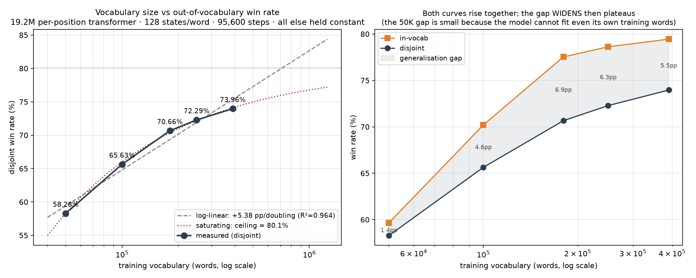

# Generalization Bottlenecks in Information-Seeking Agents Under Partial Observability

An empirical study of what limits out-of-distribution generalization in a
sequential information-acquisition agent. **Generalization scales with environment
diversity, and is nearly insensitive to how densely each environment is sampled.**
Across an 8× vocabulary sweep at fixed compute, disjoint win rate rises
**58.28% → 73.96%**, a clean **+5.38pp per doubling** (R² = 0.964) that saturates
toward an estimated ceiling near 80%. The two obvious levers do almost nothing:
quadrupling parameters buys +1.5pp while *doubling* the memorization gap, and
doubling the sampling of the same environments buys +0.03pp — 12 words out of
45,060. Sample density turns out to control memorization (±9pp of gap) rather
than competence (±1pp of disjoint win rate).

---

## Problem

An agent observes a partially masked string and must recover it by querying one
symbol at a time. Each query returns *every* position matching that symbol, or
nothing; the agent is eliminated after 6 unsuccessful queries. This is sequential
information acquisition under a hard budget: the latent state is never observed
directly, each action is simultaneously an information probe and an irreversible
expenditure, and the optimal policy must trade immediate payoff probability
against expected information gain. Evaluation is adversarial to memorization — the
agent is scored on 45,060 strings sharing **zero** vocabulary overlap with
anything it trained on. Every number below is a pair, in-distribution and
disjoint, because the *gap* between them is the only reliable memorization
detector we found.

## Approach

A character-level transformer trained as a masked language model, but conditioned
on the full game state rather than the string alone. Two properties distinguish it
from standard MLM:

**Masking is letter-level, never position-level.** Revealing a symbol reveals all
of its occurrences at once, so a state like `l_tter` is unreachable during play.
81.3% of the vocabulary contains a repeated letter, so position-level masking
places most training examples outside the reachable state space entirely.

**The agent conditions on negative evidence.** The input carries a 26-dim vector
of symbols queried and found absent. `_a__` with `e` untried and `_a__` with `e`
ruled out are different states, and roughly half the information in a played game
is negative.

## Key finding

**Out-of-distribution generalization scales with environment diversity — the
number of distinct environments — and is nearly insensitive to how densely each
environment is sampled.** Five training runs, identical in every respect except
vocabulary size (19.2M per-position transformer, 128 states per word, exactly
95,600 optimizer steps, effective batch 2048, same schedule and hardware, nested
word subsets drawn from one distribution):



| training vocabulary | in-distribution | **disjoint** | gap |
|---|---|---|---|
| 50,000 | 59.65% | **58.28%** | 1.37pp |
| 100,000 | 70.20% | **65.63%** | 4.57pp |
| 180,000 | 77.53% | **70.66%** | 6.87pp |
| 250,000 | 78.62% | **72.29%** | 6.33pp |
| 390,204 | 79.45% | **73.96%** | 5.49pp |

**+5.38 pp per doubling of vocabulary** (log-linear, R² = 0.964), but the curve
is visibly saturating: per-doubling gains decay **+7.35 → +5.05 → +2.61pp**
across the range. A saturating fit (`y = A − B·x^−c`) puts the ceiling at
**≈ 80%**, about 6pp above the largest run. Another doubling to ~780K words
should be worth +2–3pp, not +5.4 — the lever still works, but the cheap gains
are behind us.

### Isolating diversity from density

The two are easy to confound, because enlarging a vocabulary at a fixed state
budget also thins the sampling of each word. Two controlled comparisons separate
them. Both hold vocabulary at 180,240 words and vary only states per word:

| | states/word | in-distribution | **disjoint** | gap |
|---|---|---|---|---|
| dense | 277 | 85.34% | **69.66%** | **15.68pp** |
| sparse | 128 | 77.53% | **70.66%** | **6.87pp** |

Halving sample density **improves disjoint win rate by 1.04pp** while cutting
in-distribution performance by 7.8pp and the memorization gap by 8.8pp. Doubling
it in the other direction (50M → 100M states on the same words) moved disjoint by
**+0.03pp — 12 words out of 45,060, statistically zero** — even though the second
pool measurably reshaped the state distribution (opening states 14.7 → 26.4%,
endgame 14.4 → 25.0%, corr(progress, budget) +0.003 → +0.432).

So the two axes act on different quantities:

- **Environment diversity → generalization.** +15.7pp of disjoint win rate
  across an 8× vocabulary range.
- **Sample density → memorization only.** It moves the gap by ~9pp and disjoint
  win rate by ~1pp. Denser sampling of the same environments buys recall, not
  competence.

### Full ablation grid

Each row changes exactly one variable, at identical compute:

| ablation | change | in-distribution | **disjoint** | gap |
|---|---|---|---|---|
| **Capacity** | 4.9M → 19.2M params | +10.60 | **+1.50** | 7.1 → 16.2pp |
| **Sample density** | 50M → 100M states, same words | +0.36 | **+0.03** | 16.2 → 16.5pp |
| **Sample density** | 277 → 128 states/word, same words | −7.81 | **+1.00** | 15.7 → 6.9pp |
| **Inductive bias** | pooled head → per-position head | +0.66 | **+1.17** | 16.2 → 15.7pp |
| **Environment diversity** | 50K → 390K words | +19.80 | **+15.68** | 1.4 → 5.5pp |

Capacity is the instructive failure: 4× the parameters raises in-distribution
performance 10.6pp and *more than doubles the memorization gap*, to buy 1.5pp of
generalization. It is spent almost entirely on recall.

### The gap is not a generalization score

The 50,000-word run has the smallest gap in the study (1.37pp) and the worst
generalization (58.28%). Its gap is small because in-distribution performance is
only 59.65% — the model cannot fit even its own training set. A narrow gap means
"not memorizing", which is only informative once in-distribution performance is
high. Read alone it inverts the ranking; read alongside in-distribution
performance it is the most reliable memorization detector we found.

### The effect is specific to the learned model

An n-gram backoff control over the same vocabulary sweep is flat — 55.32% →
55.22% → 55.28% → 55.87% at 90K / 126K / 153K / 180K words, non-monotone and
inside noise. A counting model extracts a fixed feature set per word and
saturates; the neural model keeps finding structure in additional environments.
Diversity scaling is a property of what is being learned, not of the data.

## Architecture

```
pattern (29 tokens: a-z, blank, pad) ──► embedding + sinusoidal position ──┐
                                                                           ├──► 6-layer
eliminated set (26-dim) ──► Linear(26, d_model) ──► broadcast to positions ─┘    pre-LN
                                                                                encoder
                                                                                   │
                                        ┌──────────────────────────────────────────┘
                                        ▼
                    per-position head: 26 logits at EVERY position
                                        │
                    aggregate:  P(present) = 1 − Π_blanks (1 − p_blank)
                                        │
                    mask already-queried symbols to −inf ──► argmax
```

- **Input:** masked pattern + eliminated set. The eliminated vector is projected
  into model dimension and injected at every position, so each slot conditions on
  negative evidence directly.
- **Output:** 26-way multi-label, not softmax — several symbols are simultaneously
  correct, and the multi-label form is what lets the model say so. Objective is BCE
  on "is symbol L present and not yet revealed".
- **Per-position head.** A pooled head predicts 26 numbers for the whole string,
  which structurally forbids representing "slot 1 is probably `e`, slot 4 is
  probably `o`". The per-position head gives 26 × n_blanks supervised values per
  state instead of 26 — roughly 5× the gradient signal from identical data, which
  is the lever that matters on a task measured to be data-limited. Worth +1.17pp
  on its own; aggregation runs in log space to avoid underflow across up to 29
  blanks.
- **Training pipeline:** letter-level masking → 50M synthetic states (reveal count
  uniform over distinct letters, wrong-query count uniform 0–5, wrong queries drawn
  from genuinely absent symbols by frequency-weighted reservoir sampling) → stored
  word-major as memory-mapped int8/uint32 → 8 invariants asserted before training.
  Validation splits **by word, not by row**, since a row split puts states from one
  word on both sides and reports a score inflated by memorization.
- **Config:** 6 layers, d_model 512, 8 heads, FFN 2048, pre-LN, GELU, dropout
  0.1, 19.2M parameters, fp16, ~8h on one RTX 2080 Ti.

## Results

45,060 disjoint strings, zero vocabulary overlap. `avg wrong` is over solved
strings; `gap` is in-vocab minus disjoint.

| model | in-vocab | **disjoint** | avg wrong | gap |
|---|---|---|---|---|
| fixed symbol order (control) | 10.5% | 10.0% | 4.08 | — |
| frequency baseline | 13.5% | 13.8% | 3.98 | −0.3pp |
| dictionary candidate filtering | 95.9% | 15.0% | 3.79 | **80.9pp** |
| n-gram backoff, 12 two-sided templates | 60.35% | 55.59% | 3.077 | 4.8pp |
| CatBoost, 26 per-symbol GBMs (2M states) | 62.99% | 57.55% | 2.962 | 5.4pp |
| CatBoost tuned (4M states, 3000 iters) | 63.89% | 58.03% | 2.937 | 5.9pp |
| transformer R0 (4.9M, pooled) | 74.09% | 67.00% | 2.400 | 7.1pp |
| transformer A1 (19.2M, pooled) | 84.69% | 68.50% | 2.286 | 16.2pp |
| transformer C1 (19.2M, 100M states) | 85.05% | 68.52% | 2.276 | 16.5pp |
| transformer P1 (19.2M, per-position) | 85.34% | 69.66% | 2.245 | 15.7pp |
| P1 + n-gram blend (w=0.60) | — | 70.17% | 2.264 | — |
| transformer S180 (180K vocab, 128 states/word) | 77.53% | 70.66% | 2.23 | 6.9pp |
| transformer S250 (250K vocab, per-position) | 78.62% | 72.29% | 2.20 | 6.3pp |
| **transformer V1 (390K vocab, per-position)** | 79.45% | **73.96%** | **2.165** | **5.5pp** |
| **V1 + n-gram blend (w=0.75)** | — | **74.12%** | 2.175 | — |

### Negative results

| experiment | result | diagnosis |
|---|---|---|
| **DAgger on-policy retraining** | 67.00% → **65.42%** | In-vocab rose 7.25pp while disjoint *fell* and the gap doubled. The on-policy pools were small (1.78M + 1.90M states) and tied to a fixed word list, replaying each state ~25× more often than a uniform one. Diversity beats distribution-match on an OOD task. |
| **Depth-1 expectimax** | 67.00% → **43.03%**, then **21.88%** after fixing two real bugs | The "fix" being worse was the tell — the bugs were not the cause. The value function was fitted only on greedily-visited states (AUC 0.826 there) and then queried off-distribution; its importances (entropy 31.9 vs budget 11.6) made it prefer whichever query left the tidiest posterior, barely charging for the life spent. |
| **2× distinct states (100M pool)** | 68.50% → **68.52%** | 12 words out of 45,060, and the gap got *wider*. Falsified the inference that "data-limited" meant state-limited. See the key finding. |
| **Pretrained CANINE-s (133M)** | **64.25%** vs 69.66% from scratch (per-position, same vocabulary) | Plateaued after ~30M states, ~15% of what the from-scratch model consumed. An LR sweep (2e-4 vs 5e-4) moved 0.3pp, confirming the bottleneck was data volume, not optimization. |
| **CatBoost, 26 per-symbol GBMs** | capped at **58.03%** | 2M→4M states and 500→3000 iterations bought +0.48pp for 3.5× the training time. A ceiling, not a tuning problem. |
| **Probability renormalization in the blend** | below raw blending at every matched weight | Both components estimate the same quantity on a common scale; normalizing discards the absolute confidence that made them combinable. |
| **Confidence routing** | −1.35pp at 8.9% routed, −5.52pp at 49.1% routed | Degraded monotonically with traffic handed to the n-gram. Low model confidence marks a genuinely hard state, not one where the weaker model knows better. |

The blend sweep is monotone from w=1.00 (69.66%) to w=0.60 (70.17%), but the last
increments — +0.09, +0.06, +0.02pp — are 9, 27 and 1 words against an unpaired
standard error of ~0.22pp. The trend and the ~+0.5pp total are real; the exact
optimum is not identifiable at this resolution.

## Reproduce

Place your training word list at `data/train.txt` (one word per line, lowercase
a-z). No word list is distributed with this repository; the results above were
measured on a 225,300-word list, split 80/20 by the first step below.

```bash
pip install -r requirements.txt

# 1. 80/20 word split, seed 42, shuffled (fully disjoint holdout).
#    Regenerates data/train_split.txt and data/holdout_split.txt deterministically.
python src/split_data.py

# 2. Expand the environment vocabulary. --external takes any general English
#    word list (e.g. /usr/share/dict/words). Every --forbid word is asserted
#    absent from the output before it is written.
python build_augmented_vocab.py \
    --base data/train_split.txt --external /usr/share/dict/words \
    --forbid data/holdout_split.txt --out data/train_augmented.txt

# 3. Generate 50M states with letter-level masking, then assert 8 invariants
python src/generate_training_data.py \
    --words data/train_augmented.txt --out data/states --n-states 50000000
python src/validate_states.py --dir data/states

# 4. Train (~8h on one RTX 2080 Ti)
python train_transformer.py --states-dir data/states --positional \
    --layers 6 --d-model 512 --nhead 8 --ff 2048 \
    --batch-size 2048 --epochs 4 --out models/transformer_V1.pt

# 5. Benchmark on both splits; reports in-vocab, disjoint and gap
python run_transformer_benchmark.py \
    --checkpoint models/transformer_V1.pt --positional
```

**Leakage.** A general English word list contains ~92% of the holdout, so step 2
is where this study lives or dies. Separation is enforced four independent ways:
the builder asserts disjointness before writing, state generation re-checks the
generated pool's own word list, and the written vocabulary was verified after the
fact to intersect the 45,060-word holdout in exactly **0** entries while covering
all 180,240 original training words. If you substitute a different external list,
re-run the assertions — do not assume.

The ablations: capacity via `--d-model`/`--layers`; sample density via
`--n-states` and `src/mixture_dataset.py`; inductive bias by dropping
`--positional`; diversity via `build_vocab_subsets.py`, which draws *nested*
subsets from one shuffled pool so each point differs in size alone.
`run_model_comparison.py` gives pairwise error correlation (φ, both-lose, union,
McNemar) between two models; `run_paired_test.py` runs McNemar on sub-point
differences. All seeds fixed.

## Layout

`src/` holds the models: `transformer_positional.py` (per-position head,
log-space aggregation) and `transformer_model.py` (pooled baseline, shared
encoding, eliminated-set injection); `generate_training_data.py` (letter-level
masking) and `validate_states.py` (8 invariants) build and check the state pools;
`dataset.py` / `mixture_dataset.py` are the memmap loaders with the word-boundary
split; `batch_sim.py` is the batched simulator, cross-checked against the scalar
`benchmark.py`. The comparison branches live beside them — `ngram_model.py`,
`catboost_model.py`, `expectimax.py` + `value_function.py`, `collect_onpolicy.py`
— so every negative result above stays verifiable. Top-level `train_*.py` and
`run_*.py` are the entry points.

## Limitations

The largest measured gain has no measured ceiling — the vocabulary scaling curve
is anchored at only two points (180K and 390K words), so whether generalization
saturates or keeps climbing is open, and `build_vocab_subsets.py` /
`plot_vocab_scaling.py` exist to answer it. 25.3% of holdout strings are solved by
*no* model built here, and nothing tried moved that figure. All results are one
seed per configuration; differences under ~0.5pp should be read as ties.
